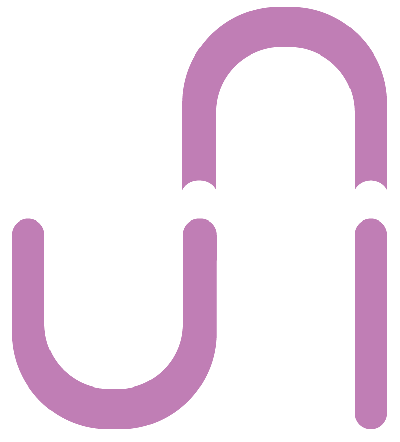

<p align="center">
  
</p>

# unios-desktop-settings

unios-desktop-settings is the package that gives UniOS its look on KDE Plasma. It ships the UniOS wallpapers and logo, sets Breeze Dark as the default theme and Firefox as the default browser, replaces the Plasma Welcome Center with our own first login setup, and puts the UniOS logo on the application launcher.

It has no code of its own to build. The config files are kept in `files/`, at the same paths they're installed to, and the `PKGBUILD` copies them into place along with the wallpapers and the logo.

## How it works

1. On install, every wallpaper goes to its own folder in `/usr/share/wallpapers/`, so they show up in Plasma's wallpaper picker as **UniOS**, **UniOS Patterns** and **UniOS Dense Patterns**, and the logo is installed as the `unios` and `distributor-logo` icons.
2. System-wide defaults in `/etc/xdg` make Breeze Dark the look and feel, color scheme, icon theme and Plasma theme, and Firefox the default browser.
3. The Plasma Welcome Center is turned off by disabling the kded module that launches it. In case it gets loaded anyway, `plasma-welcomerc` tells it this isn't a first run and not to show the update page.
4. On a user's first login, the `unios-plasma-setup.sh` autostart script waits for Plasma to start, sets the **UniOS** wallpaper on every desktop, and sets the UniOS logo as the icon of the application launcher on every panel. It doesn't run again after that, so users can change both.

Everything in steps 2 and 3 is a system-wide default, so it applies to the live session and to every user, new or existing, unless they've changed that setting in their own `~/.config`. Those config files are in the `backup` array as well: if you edit one on a machine, upgrades leave your copy alone and put the new one next to it as `.pacnew`.

## Installation

### As a user

**On UniOS**, unios-desktop-settings is preinstalled. If you removed it, install it again from `unios-repo`:

```bash
sudo pacman -S unios-desktop-settings
```

**On other Arch-based distributions** running KDE Plasma, build the package from the `PKGBUILD` in this repository:

```bash
git clone https://github.com/open-source-uom/unios-desktop-settings.git
cd unios-desktop-settings
makepkg -si
```

Log out and back in afterwards, so the setup script runs.

### As a developer

You only need `base-devel` and a KDE Plasma session to test the result:

```bash
sudo pacman -S base-devel
```

The `PKGBUILD` builds from the checkout, so run `makepkg` from the root of the repository. Build the package without installing it, and check what it would install:

```bash
makepkg -f
tar -tf unios-desktop-settings-*.pkg.tar.zst
```

When you're happy with it, install it with `makepkg -si` and log in again. The setup script only runs once per user, so if you already logged in with it installed, delete `~/.local/state/unios/plasma-setup.done` first.

Every push and pull request to `main` also gets built in an Arch container on GitHub Actions. It runs `shellcheck` on the setup script, `desktop-file-validate` on the autostart entry and `jq` on the wallpapers' `metadata.json`, then builds the package with `makepkg`. `namcap` runs last but only reports: it flags dependencies it can't see being used, like `qt6-tools` for `qdbus6`.

To build it for `unios-repo`, bump `pkgrel` and follow the `pkgbuilder` process in [our build server](build.unios-project.eu.md) docs.

## Project Structure

```
unios-desktop-settings/
├── PKGBUILD                  package recipe
├── files/                    installed at the same path on the system
│   ├── etc/xdg/
│   │   ├── autostart/
│   │   │   └── unios-plasma-setup.desktop
│   │   ├── kded5rc
│   │   ├── kdeglobals
│   │   ├── mimeapps.list
│   │   ├── plasma-welcomerc
│   │   └── plasmarc
│   └── usr/lib/unios/
│       └── unios-plasma-setup.sh
├── resources/
│   ├── logos/
│   │   └── unios.png         the UniOS logo
│   └── wallpapers/           one KDE wallpaper package per folder
│       ├── UniOS/            the wallpaper set on first login
│       │   ├── metadata.json
│       │   └── contents/images/3840x2160.jpg
│       ├── UniOS-Dense-Patterns/
│       └── UniOS-Patterns/
└── .github/workflows/
    └── build.yml             lints and builds the package
```

### Files the package installs

| Path | What it is |
| --- | --- |
| `/usr/share/wallpapers/UniOS/` | the **UniOS** wallpaper, set on first login |
| `/usr/share/wallpapers/UniOS-Patterns/` | the **UniOS Patterns** wallpaper |
| `/usr/share/wallpapers/UniOS-Dense-Patterns/` | the **UniOS Dense Patterns** wallpaper |
| `/usr/share/pixmaps/unios.png` | the UniOS logo |
| `/usr/share/icons/hicolor/256x256/apps/` | the logo as `unios` and `distributor-logo` |
| `/etc/xdg/kdeglobals` | Breeze Dark look and feel, color scheme and icons, Firefox as the browser |
| `/etc/xdg/plasmarc` | Breeze Dark Plasma theme |
| `/etc/xdg/mimeapps.list` | Firefox as the default for web links |
| `/etc/xdg/kded5rc` | stops the Welcome Center's kded module from loading |
| `/etc/xdg/plasma-welcomerc` | tells the Welcome Center there's nothing to show, in case it starts anyway |
| `/usr/lib/unios/unios-plasma-setup.sh` | the first login setup script |
| `/etc/xdg/autostart/unios-plasma-setup.desktop` | runs the setup script when a user logs in to Plasma |

For example, `/etc/xdg/kdeglobals` looks like this:

```ini
[KDE]
LookAndFeelPackage=org.kde.breezedark.desktop

[General]
ColorScheme=BreezeDark
BrowserApplication=firefox.desktop

[Icons]
Theme=breeze-dark
```

### The setup script

`unios-plasma-setup.sh` uses `qdbus6` (or `qdbus`, if that's what's available) to talk to `plasmashell`. It tries for up to 15 seconds until Plasma answers, then runs a Plasma script that:

* sets the **UniOS** wallpaper package, `/usr/share/wallpapers/UniOS/`, on every desktop
* finds every Kickoff or Kicker widget on every panel and sets `/usr/share/pixmaps/unios.png` as its icon

Once Plasma has run it, the script leaves `~/.local/state/unios/plasma-setup.done` behind. On every login after that it finds the file and exits right away, so the wallpaper and launcher icon a user picks stay. If Plasma never answered, nothing is written and it tries again on the next login. Delete that file to run it again.

It only runs in Plasma sessions, in autostart phase 2, after the desktop and panels have loaded, and it doesn't write anything outside of Plasma's own config and that file.

## Adding a Wallpaper

Every folder in `resources/wallpapers/` is a KDE wallpaper package of its own, installed to `/usr/share/wallpapers/` under the same name.

1. Make a new folder in `resources/wallpapers/`.
2. Copy `metadata.json` from one of the others, then set `Id` to the folder name and `Name` to what the wallpaper picker should show.
3. Put the image in `contents/images/` inside it, named after its resolution, e.g. `3840x2160.jpg`. Plasma picks the image by that name and skips files named anything else.
4. Bump `pkgrel` in the `PKGBUILD` (or `pkgver`, and reset `pkgrel` to `1`) so users get the update.

To change the wallpaper that is set on first login, replace the image in `resources/wallpapers/UniOS/contents/images/`, since the setup script points at the `UniOS` package.

## Changing the Logo

Replace `resources/logos/unios.png`. It's installed as `/usr/share/pixmaps/unios.png`, which the setup script puts on the launcher, and as the `unios` and `distributor-logo` icons.

## Recent Changes

* The packaging was refactored in [#13](https://github.com/open-source-uom/unios-desktop-settings/pull/13):
    * The config files and the setup script moved out of the `PKGBUILD` into `files/`, and the `PKGBUILD` builds straight from the checkout.
    * Every wallpaper is its own KDE wallpaper package now, with the image named after its resolution, which is how Plasma finds it. Before, they were all in one package with no image Plasma could use, so the patterns could never be picked. They were also scaled down from 8001x4501 to 3840x2160, with the same colours.
    * The setup script runs once per user instead of on every login, so users can change the wallpaper and the launcher icon and keep them. It also only runs on Plasma now.
    * The logo is no longer installed as a wallpaper or as the `start-here-kde` icon, since Breeze Dark has its own.
    * `qt6-tools` (for `qdbus6`) and `hicolor-icon-theme` were added to the dependencies, and `firefox` to the optional ones.
    * The `/etc/xdg` config files are in the `backup` array, so local edits survive upgrades.
    * `publish_to_PPA.yml`, which couldn't build anything without `debian/`, was replaced by a CI build on Arch.
* Firefox is the default browser.
* The Plasma Welcome Center is turned off through its kded module instead of `/etc/skel`, so it's also off in the live session and for existing users.
* UniOS moved to Arch, so the Debian packaging and the Launchpad PPA were dropped in favour of a `PKGBUILD`, and the wallpapers and the logo moved to `resources/`.

## Contributors

Maintained by [Open Source UoM](https://github.com/open-source-uom), with contributions from:

<a href="https://github.com/open-source-uom/unios-desktop-settings/graphs/contributors">
  
</a>

unios-desktop-settings is part of the [UniOS project](https://unios-project.eu). Its source code is on [GitHub](https://github.com/open-source-uom/unios-desktop-settings), and changes follow the [General Dev Workflow](generalworkflow.md).
